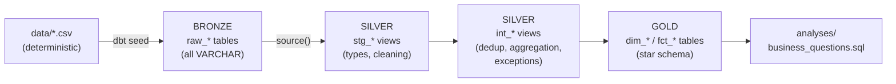

# Snowflake + dbt Medallion Warehouse

An educational, end-to-end analytics warehouse for a fictional e-commerce
business, built with **dbt Core** on **Snowflake** using a **Bronze / Silver /
Gold** (Medallion) layout and a **star schema**. It uses deterministic
synthetic data, explicit business rules, and data tests that protect real
assumptions. CI runs useful checks with or without Snowflake access.

> Validation status: the full pipeline (`dbt build`: 5 seeds, 14 models,
> 105 data tests (99 generic + 6 singular), 3 unit tests) ran successfully against Snowflake on
> 2026-10-30, with 1 intentional warning. Details and evidence are in
> [docs/validation_report.md](docs/validation_report.md).

## Business questions

Monthly gross and net sales · top products · top customers · average order
value · orders by status · sales by category and month · data-quality issues
(duplicates, orphan references, payment inconsistencies). Queries:
[`analyses/business_questions.sql`](analyses/business_questions.sql). Verified
results: [`examples/expected_query_results.md`](examples/expected_query_results.md).

## Architecture



All three layers live in one database (`MEDALLION`) as separate schemas.
Full description: [docs/architecture.md](docs/architecture.md).

| Fact | Grain |
|---|---|
| `fct_orders` | one row per order (merchandise, tax, total, payments) |
| `fct_order_items` | one row per order line (quantity, gross, discount, net) |

Dimensions: `dim_customers` (Type 1, plus an Unknown member), `dim_products`,
`dim_date`.

## Key design decisions

- **Seeds simulate ingestion.** `dbt seed` writes the raw zone for
  reproducibility only. It is not a production ingestion service. Models read
  it through `source()`, so a real loader can replace it.
- **Raw stays raw.** Seeds are all `VARCHAR`; typing and cleaning happen in
  Silver, with `TRY_` conversions so bad values surface in tests instead of
  crashing a load.
- **Grain before joins.** Payments and lines are aggregated to order grain
  before they meet, which prevents fan-out. Reconciliation tests prove it.
- **Flag, don't drop.** Invalid records go to an exception register and stay
  in the facts (an orphan order maps to an Unknown customer).
- **Explicit metrics.** Net sales exclude tax; only completed orders count as
  sales; AOV = net sales / completed orders.

Rationale for each: [docs/design_decisions.md](docs/design_decisions.md).

## Tech stack (tested versions)

| Component | Version |
|---|---|
| Python | 3.12 (`requires-python >=3.10,<3.14`) |
| dbt-core | 1.12.6 |
| dbt-snowflake | 1.12.4 |
| dbt_utils | 1.4.1 (locked in `package-lock.yml`) |
| Snowflake | reference run on server 10.39.101, X-Small Gen2 warehouse |

The dbt CLI now promotes "dbt v2" (Fusion) for new installs. This project
targets **dbt Core v1** on purpose and parses with zero deprecation warnings;
it has not been tested on v2.

## Repository structure

```
.
├── .github/workflows/dbt-ci.yml     # static checks always; Snowflake build when enabled
├── analyses/business_questions.sql  # 7 analytical queries on Gold
├── data/                            # seed CSVs + _seeds.yml (all-VARCHAR raw types)
├── docs/                            # architecture, dictionary, decisions, validation, article
├── examples/expected_query_results.md
├── macros/
│   ├── generate_schema_name.sql     # exact layer schemas + optional DBT_SCHEMA_PREFIX
│   └── drop_ci_schemas.sql          # guarded cleanup for CI_* schemas only
├── models/
│   ├── bronze/_bronze__sources.yml
│   ├── silver/staging/stg_*.sql
│   ├── silver/intermediate/int_*.sql
│   ├── silver/_silver__models.yml, _silver__unit_tests.yml
│   └── gold/{dimensions,facts}/*.sql, _gold__models.yml
├── scripts/
│   ├── generate_sample_data.py      # deterministic generator (--check mode)
│   ├── validate_sample_data.py      # offline integrity checks (CI)
│   └── reference_metrics.py         # independent Python recomputation of metrics
├── setup/01_snowflake_setup.sql     # one-time, least-privilege setup (review first)
├── setup/99_cleanup.sql             # guarded, two-step cleanup
├── tests/assert_*.sql               # singular business-rule tests
├── dbt_project.yml  packages.yml  package-lock.yml
├── profiles.yml.example  .env.example
├── requirements.txt  pyproject.toml  Makefile
```

## Prerequisites

- Python 3.10–3.13, `git`, `make` (optional).
- A Snowflake account where you may create (or already have) a database,
  three schemas, and an X-Small warehouse. **Running this project consumes
  Snowflake credits** (see [Cost](#cost-considerations)).

## 1. Snowflake setup

Review and run [`setup/01_snowflake_setup.sql`](setup/01_snowflake_setup.sql)
once, as an administrator (replace `<YOUR_USER>`). It creates:

- `MEDALLION_WH`: X-Small, `AUTO_SUSPEND = 60`, initially suspended.
- Database `MEDALLION`, with schemas `BRONZE`, `SILVER`, `GOLD`.
- Role `MEDALLION_TRANSFORMER`, with the minimum dbt needs:

| Privilege | On | Why |
|---|---|---|
| USAGE | warehouse `MEDALLION_WH` | run queries |
| USAGE, CREATE SCHEMA | database `MEDALLION` | read; CI creates isolated `CI_*` schemas |
| USAGE, CREATE TABLE, CREATE VIEW | schemas `BRONZE`, `SILVER`, `GOLD` | seeds, views, tables |

dbt does not need `ACCOUNTADMIN`. If you already have a development database,
point `SNOWFLAKE_DATABASE` at it instead and grant the same privileges there.

## 2. Credentials (key-pair authentication)

```bash
# Generate a key pair OUTSIDE the repository
mkdir -p ~/.snowflake/keys && cd ~/.snowflake/keys
openssl genrsa 2048 | openssl pkcs8 -topk8 -inform PEM -out medallion_rsa_key.p8 -nocrypt
openssl rsa -in medallion_rsa_key.p8 -pubout -out medallion_rsa_key.pub
```

In Snowflake: `ALTER USER <you> SET RSA_PUBLIC_KEY='<public key body>';`.
Use an encrypted key (drop `-nocrypt`) and set
`SNOWFLAKE_PRIVATE_KEY_PASSPHRASE` if your policy requires it.

```bash
cd snowflake-dbt-medallion-warehouse
cp .env.example .env                  # gitignored; fill in your values
cp profiles.yml.example profiles.yml  # gitignored; contains only env_var() calls
set -a && source .env && set +a
```

Never commit `.env`, `profiles.yml`, or key files (all are in `.gitignore`).

## 3. Local environment

```bash
python3 -m venv .venv
.venv/bin/pip install -r requirements.txt
source .venv/bin/activate
```

or `make venv`.

## 4. Run the pipeline

| Step | Command | What it does |
|---|---|---|
| Offline data check | `make data-check` | CSVs match the generator; keys and totals reconcile (no Snowflake) |
| Packages | `dbt deps` | installs dbt_utils at the locked version |
| Connectivity | `dbt debug` | validates profile, credentials, warehouse access |
| Compile | `dbt compile` | renders Jinja to SQL in `target/compiled` (connects to Snowflake) |
| Load raw | `dbt seed` | loads `data/*.csv` into `BRONZE.raw_*` |
| Transform | `dbt run` | builds Silver views and Gold tables |
| Test | `dbt test` | runs data tests and unit tests on built models |
| All-in-one | `dbt build` | seeds, runs, and tests in DAG order, stopping downstream on failure (**recommended**) |
| Docs | `dbt docs generate && dbt docs serve` | catalog + lineage site at http://localhost:8080 |

Typical first run:

```bash
dbt deps && dbt debug && dbt build
```

Expected: `Done. PASS=126 WARN=1 ERROR=0 SKIP=0 TOTAL=127`. The one warning
is intentional: order `O0047` references a non-existent customer.

### Isolated development schemas

To avoid touching shared `BRONZE/SILVER/GOLD`, set a prefix:

```bash
export DBT_SCHEMA_PREFIX=DEV_JDOE   # -> DEV_JDOE_BRONZE, DEV_JDOE_SILVER, DEV_JDOE_GOLD
dbt build
```

This requires `CREATE SCHEMA` on the database (or pre-created schemas).

### Controlled failure demo

```bash
make strict-test
# = dbt test --select stg_orders --vars '{strict_referential_integrity: true}'
```

Expected: `FAIL 1 relationships_stg_orders_customer_id__...` and exit code 1.
See [design decisions](docs/design_decisions.md#controlled-failure-demo).

## 5. Example queries

`dbt compile --select business_questions` renders the queries to
`target/compiled/medallion_warehouse/analyses/business_questions.sql`. Run
them in a Snowflake worksheet. For example, average order value:

```sql
select count(*) as completed_orders,
       sum(net_sales_amount) as net_sales,
       round(sum(net_sales_amount) / nullif(count(*), 0), 2) as average_order_value
from medallion.gold.fct_orders
where is_revenue_recognized;
-- 65 | 32721.47 | 503.41
```

## CI (GitHub Actions)

[`.github/workflows/dbt-ci.yml`](.github/workflows/dbt-ci.yml) runs on pull
requests and pushes to `main`:

1. **Static validation (always, no Snowflake, no credits):** required files,
   no tracked credentials or artifacts, Python syntax, data determinism and
   integrity, `dbt deps`, and `dbt parse --warn-error` (YAML, Jinja, refs, test
   configs, deprecations). This is **not** equivalent to running models.
2. **Snowflake integration (opt-in):** runs only when the repository
   variable `SNOWFLAKE_CI_ENABLED` is `true`, and never for pull requests from
   forks. Runs `dbt build` into throw-away `CI_<run_id>_<attempt>_*` schemas,
   then drops them with a macro that refuses any non-`CI_` prefix.

Configure **Settings → Secrets and variables → Actions**:

| Secret | Purpose |
|---|---|
| `SNOWFLAKE_ACCOUNT` | account identifier (`orgname-accountname`) |
| `SNOWFLAKE_USER` | dedicated service user (e.g. `MEDALLION_CI_SVC`, `TYPE = SERVICE`) |
| `SNOWFLAKE_PRIVATE_KEY` | PEM private key content of that user |
| `SNOWFLAKE_ROLE` | `MEDALLION_TRANSFORMER` (never ACCOUNTADMIN) |
| `SNOWFLAKE_WAREHOUSE` | `MEDALLION_WH` |
| `SNOWFLAKE_DATABASE` | a **development** database (e.g. `MEDALLION`), never production |

| Variable | Value |
|---|---|
| `SNOWFLAKE_CI_ENABLED` | `true` to enable the Snowflake job |

The service-user DDL is commented in `setup/01_snowflake_setup.sql`. There is
no production deployment job.

## Troubleshooting

| Symptom | Likely cause / fix |
|---|---|
| `Env var required but not provided: 'SNOWFLAKE_ACCOUNT'` | `.env` not exported: `set -a && source .env && set +a` |
| `JWT token is invalid` | public key not set on the user, or wrong account identifier format |
| `Object does not exist or not authorized` on a schema | missing USAGE/CREATE grants for your role (see setup table) |
| `Insufficient privileges to operate on database` with a prefix | `DBT_SCHEMA_PREFIX` needs CREATE SCHEMA on the database |
| `DBT_SCHEMA_PREFIX must match …` | prefix must be letters, digits, underscores, starting with a letter |
| `WARN 1 relationships_stg_orders_customer_id…` | expected; the intentional orphan order |
| A test fails after editing a model | `dbt test --select <test_name> --store-failures` and query the stored failure rows |

## Security considerations

- No secrets in the repository. `profiles.yml.example` reads only environment
  variables, and key files live outside the repo.
- Key-pair authentication; a separate service user for CI.
- dbt runs with a role that has no account-level privileges.
- `DBT_SCHEMA_PREFIX` is validated before it reaches DDL. CI cleanup cannot
  drop non-`CI_` schemas.
- All data is synthetic (reserved `example.*` email domains).

## Cost considerations

Executing dbt and queries **consumes Snowflake credits** (compute) and a small
amount of storage. Safeguards: X-Small warehouse, `AUTO_SUSPEND = 60`, a small
dataset, no schedules or polling, the Snowflake CI job off by default, and an
optional resource monitor in the setup script. For scale: the reference
session ran roughly 700 dbt-issued queries over several full builds, totaling
about 154 seconds of query execution time. Billed credits also depend on
warehouse resume minimums and idle time before auto-suspend, so check your
own usage in `ACCOUNT_USAGE.WAREHOUSE_METERING_HISTORY`.

## Known limitations

- Seeds are not an ingestion pipeline (no incremental loads, no schema drift,
  no load audit).
- Customers are Type 1; no history is kept.
- Tax is not allocated to order lines.
- Single currency; no FX handling.
- The reference Snowflake run used `ACCOUNTADMIN` in a personal trial account.
  The least-privilege setup script has been reviewed and its CREATE
  statements compiled, but it has not been executed end to end.
- The CI Snowflake job has not yet run on GitHub. The same commands were
  executed locally with a `CI_` prefix (see the validation report).

## Cleanup

Follow [`setup/99_cleanup.sql`](setup/99_cleanup.sql): first list what is in
the schemas, then generate `DROP` statements limited to this project's object
name patterns, review them, and run them. Warehouse and role drops are
commented out on purpose. To remove local artifacts, run `dbt clean`.

## Further reading

- Article: [docs/article.md](docs/article.md)
- [dbt Core installation](https://docs.getdbt.com/docs/core/installation-overview) ·
  [dbt-snowflake setup](https://docs.getdbt.com/docs/core/connect-data-platform/snowflake-setup) ·
  [Custom schemas](https://docs.getdbt.com/docs/build/custom-schemas) ·
  [Data tests](https://docs.getdbt.com/docs/build/data-tests) ·
  [Unit tests](https://docs.getdbt.com/docs/build/unit-tests) ·
  [Deprecations](https://docs.getdbt.com/reference/deprecations)
- [Snowflake key-pair authentication](https://docs.snowflake.com/en/user-guide/key-pair-auth) ·
  [Warehouse considerations](https://docs.snowflake.com/en/user-guide/warehouses-considerations) ·
  [Resource monitors](https://docs.snowflake.com/en/user-guide/resource-monitors)
- Optional future path: [dbt Projects on Snowflake](https://docs.snowflake.com/en/user-guide/data-engineering/dbt-projects-on-snowflake)
  can run this same project inside Snowflake. It is not required here and has
  not been tested with this repository.

## License

No license has been chosen yet. Until a `LICENSE` file is added, default
copyright applies and others may not reuse the code. Common choices for
educational repositories are MIT and Apache-2.0.
