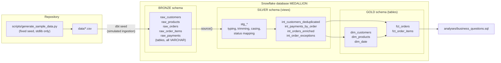
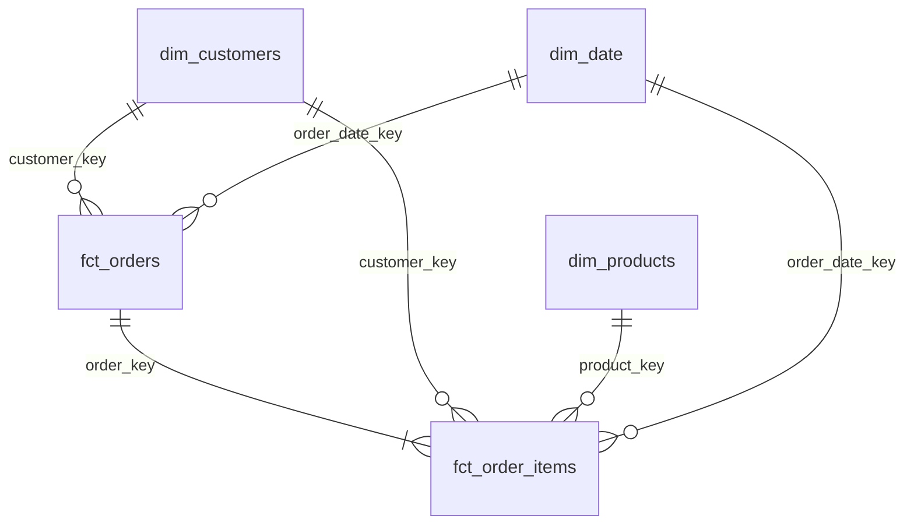

# Architecture

## Data flow

## Layers

| Layer | Schema | Built by | Materialization | Responsibility |
|---|---|---|---|---|
| Bronze | `BRONZE` | `dbt seed` | table | Raw landing zone. Exact source text, every column `VARCHAR`, plus file metadata (`_record_id`, `_source_file`, `_extracted_at`). Declared as dbt **sources**. |
| Silver – staging | `SILVER` | `stg_*` models | view | One model per source table, same grain as the source. Types, trimming, casing, NULL handling, canonical status values. No joins. |
| Silver – intermediate | `SILVER` | `int_*` models | view | Business rules that need more than one row: customer deduplication, payment aggregation to order grain, order enrichment, exception register. |
| Gold | `GOLD` | `dim_*`, `fct_*` | table | Star schema for consumption, with surrogate keys and an unknown-member row. |

The spec mentions a separate RAW schema. Per the project's Snowflake
requirements (one database `MEDALLION`, schemas `BRONZE`, `SILVER`, `GOLD`
only), the raw seed tables *are* the Bronze layer. Typing therefore happens in
Silver staging, and Bronze stays an untouched copy of the export.

## Star schema

| Fact | Grain | Measures |
|---|---|---|
| `fct_orders` | one row per order | merchandise (gross, discount, net), tax, order total, captured/refunded/net paid, outstanding |
| `fct_order_items` | one row per order line | quantity, unit price, gross, discount, net |

Tax and payments exist only at order grain. They are **not** allocated to
lines, so summing them from `fct_order_items` is impossible by construction.

## Schema naming and environments

`macros/generate_schema_name.sql` maps each layer's custom schema to an exact
name, optionally prefixed by `DBT_SCHEMA_PREFIX`:

| `DBT_SCHEMA_PREFIX` | Schemas used |
|---|---|
| *(unset)* | `BRONZE`, `SILVER`, `GOLD` |
| `DEV_JDOE` | `DEV_JDOE_BRONZE`, `DEV_JDOE_SILVER`, `DEV_JDOE_GOLD` |
| `CI_<run_id>_<attempt>` | throw-away CI schemas, dropped after the run |

The database comes from the profile target (`SNOWFLAKE_DATABASE`). No model
SQL contains a database or schema name.
